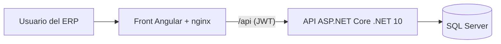
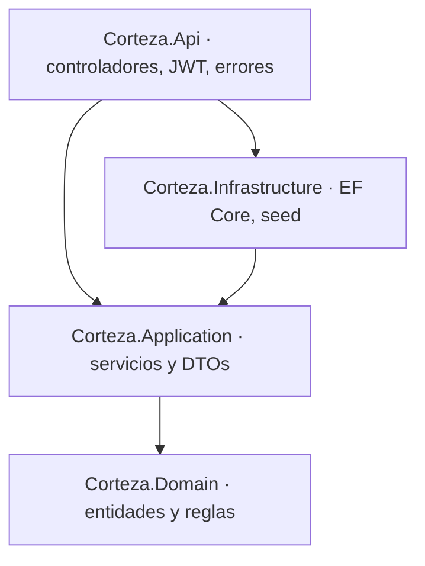

# 5. Vista de bloques de construcción

## 5.1 Nivel 1: el sistema

| Bloque | Responsabilidad | Tecnología |
|---|---|---|
| Front (`corteza-bakery`) | Pantallas por módulo; filtra rutas y menú según el rol | Angular 22, servido por nginx |
| API (`corteza-bakery-back`) | Reglas de negocio, autenticación, autorización | ASP.NET Core, .NET 10 |
| Base de datos | Persistencia | SQL Server (colación `Modern_Spanish_CI_AI`) |

nginx también reenvía `/api/*` a la API, de modo que el navegador habla con un solo origen y no hace falta CORS.

## 5.2 Nivel 2: capas de la API

- **Dominio** no depende de nada: entidades, enums y reglas (por ejemplo, el stock nunca queda negativo).
- **Aplicación** orquesta casos de uso y valida; si una regla falla no se llama a `SaveChanges`.
- **Infraestructura** implementa la persistencia con EF Core y carga los datos de demostración.
- **API** expone los controladores y traduce las excepciones de negocio a `422` con `ProblemDetails`.

Decisión: la API es un **monolito modular**, no microservicios. Cada módulo (nómina, compras, ventas…) vive en su carpeta de `Features`, lo que permite extraerlo más adelante si hiciera falta.

## 5.3 Módulos del ERP

| Módulo | Contenido |
|---|---|
| Proveedores | Alta con NIT y correo válidos, desactivación, presupuesto |
| Inventario | Insumos, entradas y salidas, stock mínimo |
| Compras | Solicitudes de cotización, órdenes de compra, facturas de compra |
| Ventas | Pedidos, mesas, cobro, facturas de venta y anulación |
| Talento Humano | Empleados, periodos de nómina y comprobantes |
| CRM | Clientes |
| Reportes | Resumen para el administrador |
