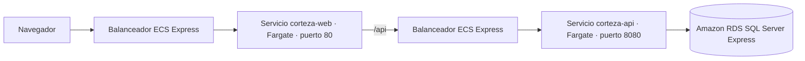

# 7. Vista de despliegue

Corteza se empaqueta en **dos imágenes** (API y front) y se puede ejecutar de cuatro formas. Todas usan las mismas imágenes y se configuran solo con variables de entorno.

| Entorno | Estado | Cómo |
|---|---|---|
| Docker Compose (local) | Ejecutado y verificado | `docker compose up --build` |
| AWS (ECS Express + RDS) | **Desplegado** | Ver 7.3 |
| Kubernetes | Manifiestos escritos, no aplicados | `k8s/` |
| Azure (Terraform) | Código escrito, **no aplicado ni validado** | `infra/terraform` |

## 7.1 Imágenes

- `corteza-api`: build multi-etapa (SDK .NET 10 → runtime ASP.NET), usuario sin privilegios, escucha en el **8080**.
- `corteza-web`: build de Angular y nginx. Reenvía `/api` a `API_UPSTREAM` y usa `$proxy_host` como `Host`, necesario cuando la API está en otro dominio HTTPS.
- Se publican en GitHub Container Registry con GitHub Actions (`docker.yml`).

## 7.2 Configuración de la API (variables de entorno)

| Variable | Uso |
|---|---|
| `ConnectionStrings__Corteza` | Cadena de conexión a SQL Server |
| `Jwt__Key` | Llave de firma de los JWT (32 caracteres o más) |
| `Seed__DefaultPassword` | Contraseña de los usuarios de demostración |
| `Database__InitialiseOnStartup` | `true` aplica migraciones y carga datos demo al arrancar |

Sondeos: API `GET /health`, front `GET /healthz`.

## 7.3 AWS (desplegado)

- Región `us-east-2` (Ohio). La base `corteza-db` está en la VPC por defecto y sin acceso público; el grupo de seguridad solo admite el puerto 1433 desde `172.31.0.0/16`.
- Los dos servicios se crearon con **ECS Express Mode** a partir de las imágenes públicas de GHCR.

### Problemas encontrados y cómo se resolvieron

| Síntoma | Causa | Solución |
|---|---|---|
| `Name or service not known` | Nombre del servidor mal escrito en la cadena | Corregir con el punto de enlace real de RDS |
| `Login failed for user 'admin'` | La clave llevaba los signos `<` `>` del marcador de ejemplo | Quitar los signos y alinear la clave con la de RDS |
| 503 permanente aunque la API arrancaba | El formulario de actualización devolvió el **puerto del contenedor a 80**; la API escucha en 8080 | Volver a poner `8080` en el servicio |

## 7.4 Kubernetes

`k8s/` contiene namespace, SQL Server con volumen, API ×2, front ×2 e ingress. Los secretos se crean con `kubectl create secret`; `secret.example.yaml` es solo una plantilla. **No se aplicaron en un clúster** durante esta entrega.

## 7.5 Azure (infraestructura como código)

`infra/terraform` define, con la misma plantilla para `dev`, `qa` y `prod` (variable `environment`): grupo de recursos, Azure SQL serverless, entorno de Container Apps con la API y el front, y un espacio de Log Analytics. El estado vive en un backend remoto `azurerm` creado una sola vez con `infra/bootstrap`; Azure Blob bloquea el estado mientras alguien ejecuta `plan` o `apply` y su versionado permite volver atrás.

El workflow `terraform-plan.yml` comenta el plan en cada pull request que cambie archivos `.tf`. Autentica con OIDC, sin guardar contraseñas.

> **Limitación declarada:** este código no se ejecutó (no había suscripción de Azure activa ni `terraform` instalado en el equipo donde se escribió), de modo que no pasó por `terraform validate` ni `plan`. Debe validarse antes de aplicarse.
