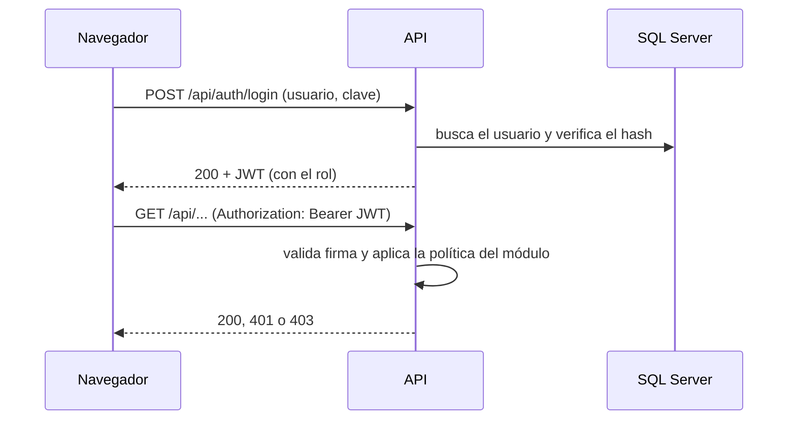

# 10. Calidad y seguridad

## 10.1 Autenticación

El usuario inicia sesión con `POST /api/auth/login` y recibe un **JWT** firmado con HMAC (`Jwt__Key`, mínimo 32 caracteres; la API no arranca si es más corta). El token lleva el identificador, el nombre, el usuario y el **rol**, y vence a los 480 minutos (un turno). Las contraseñas se guardan con hash.

## 10.2 Roles y políticas

Cada usuario tiene **un** rol. El administrador accede a todo; los demás, solo a su módulo. La seguridad real está en la API (una política por módulo en `Policies.cs`); los guards de Angular solo esconden pantallas.

| Política | Roles permitidos |
|---|---|
| `Crm` | CRM, ADMIN |
| `Sales` | SALES, CRM, ADMIN |
| `InventoryRead` | INVENTORY, PURCHASES, ADMIN |
| `InventoryWrite` | INVENTORY, ADMIN |
| `SuppliersRead` | SUPPLIERS, PURCHASES, INVENTORY, ADMIN |
| `SuppliersWrite` | SUPPLIERS, ADMIN |
| `Purchases` | PURCHASES, ADMIN |
| `Hr` (empleados y nómina) | HR, ADMIN |
| `Admin` (reportes) | ADMIN |

Como el rol viaja dentro del JWT, un cambio de rol se aplica en el siguiente inicio de sesión.

> **Pendiente:** la API no tiene todavía un endpoint ni una pantalla para que el administrador reasigne roles. El rol se define al crear el usuario (datos de demostración).

## 10.3 Gestión de secretos

- La llave JWT, la contraseña de SQL y la de los usuarios demo **no están en el repositorio**: llegan por variables de entorno, secretos de Kubernetes o variables de Terraform marcadas `sensitive`.
- Las contraseñas de `docker-compose.yml` y de `appsettings.Development.json` son solo para desarrollo local.
- La base de datos no es pública: en AWS solo acepta tráfico desde la VPC.

## 10.4 Escenarios de calidad

| Atributo | Escenario | Cómo se comprueba |
|---|---|---|
| Seguridad | Un usuario sin el rol pide un recurso de otro módulo → `403` | Política `[Authorize(Policy = ...)]` por controlador |
| Seguridad | Petición sin token → `401` | Verificado contra la API desplegada: el login con clave falsa devuelve `401` |
| Integridad | Una regla de negocio falla → no se guarda nada y se responde `422` | Pruebas de aplicación con `SaveChanges` simulado |
| Disponibilidad | Un contenedor deja de responder `/health` → la plataforma lo reemplaza | Sondeos configurados en Compose, Kubernetes, ECS y Container Apps |
| Portabilidad | La misma imagen corre en Docker, AWS y Azure sin recompilar | Verificado en Docker y AWS |
