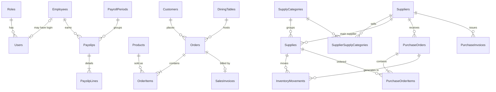

# Corteza ERP — Plan de implementación (SQL Server + .NET 10 + Angular 22)

> Fuente: Figma "Corteza – Mockups Sprint 1", documentos de Sprint 1 y Sprint 2 (Ingeniería de Software II · UdeC · 601N).
> Versión 2 del plan: se cambió PostgreSQL por **SQL Server**, que es el motor definido desde el Sprint 0.

---

## 0. Estado actual del repositorio

| Fase | Qué incluye | Estado |
|---|---|---|
| 0 · Setup | Monorepo, SQL Server (LocalDB o Docker), solución .NET en 4 capas, Angular 22 zoneless | ✅ Hecho |
| 1 · Auth + Shell | Roles (seed en migración), 7 usuarios demo, login JWT, redirección por rol, menú por rol | ✅ Hecho |
| 2 · Maestros | CRUD de clientes, proveedores (con categorías), insumos + entradas/salidas, empleados; inicio del admin | ✅ Hecho |
| 3 · Ventas | Pedidos, mesas, cobro y facturas de venta | ⏳ Modelo listo, falta API y pantallas |
| 4 · Compras | Órdenes de compra, recepción (genera entradas), facturas de compra | ⏳ Modelo listo, falta API y pantallas |
| 5 · Nómina | Periodos, comprobantes, aprobación | ⏳ Modelo listo, falta API y pantallas |
| 6 · Reportes | Ventas 7 días, top productos, insumos críticos, disponibilidad | ⏳ Pendiente |
| 7 · Cierre | Pruebas de integración, PDFs, CI | ⏳ Pendiente |

⚠️ **La API no se pudo compilar en el entorno donde se generó** (NuGet bloqueado). Se verificó la sintaxis de todo el C# y los tipos de la capa `Application` contra un stub de EF Core, y el front compila y se probó visualmente. **El primer `dotnet build` en tu equipo es la verificación real.**

---

## 1. Hallazgos que hay que resolver con el equipo

Mockups (Sprint 1):

1. **No hay pantallas de productos de venta, mesas ni usuarios.** Se cargan por seed. El CRUD de productos puede ir en el módulo del administrador.
2. **Precio inconsistente:** el jugo de naranja vale $5.000 en 02.2 y $3.500 en 02.5. Por eso cada línea del pedido guarda su `UnitPrice`. El seed usa $5.000.
3. **"Registrar salida"** (03.1) no tenía pantalla: se resolvió con el mismo formulario de entrada (selector Entrada/Salida).
4. **Conteos que no cuadran** entre pantallas (36 vs. 33 empleados, 42 vs. 46 clientes). Los contadores ahora salen de la BD.
5. **Nómina (06.3):** el cálculo legal completo es un proyecto en sí. Recomendación: reglas simples en la fase 5.
6. **Sin IVA ni facturación electrónica DIAN**: fuera de alcance (backlog Sprint 2, ítem 8: "No tendrá ahora").
7. **Permisos del vendedor de CRM:** el inicio de CRM (01.0) muestra "Nuevo pedido". Se asumió que CRM también entra a Ventas (`Policies.Sales`).

Documentos:

8. ⚠️ **El diagrama C4 de contenedores (Sprint 1, anexo A.7) dice PostgreSQL y Node.js/Spring Boot**, pero el resto del documento dice .NET + SQL Server. Hay que corregir el diagrama.
9. ⚠️ **Stock inicial:** la regla del Sprint 2 (taller 4) dice "el stock inicial es cero", pero el mockup 03.2 pide "Cantidad que hay ahora". Se siguió el mockup: si es mayor que cero, se registra como **entrada inicial** para que el historial cuadre. Si el equipo prefiere la regla del Sprint 2, se quita el campo `InitialStock`.
10. ⚠️ **.NET 8 vs .NET 10:** el Sprint 2 usa .NET 8, pero **su soporte termina el 10 de noviembre de 2026**. La API va en **.NET 10 (LTS)**. Volver a .NET 8 es posible (ver `api/README.md`), pero exige cambiar el OpenAPI integrado por Swashbuckle.
11. **Clave de Jira en los commits:** el RNF-20 pide `REP-xxx`, pero el proyecto en Jira usa `COR`. Unificar.

---

## 2. Arquitectura

```
┌────────────────────┐   HTTP/JSON + JWT   ┌──────────────────────┐   EF Core 10   ┌───────────────────┐
│ Angular 22 (web/)  │ ──── /api/* ──────▶ │ ASP.NET Core (api/)  │ ─────────────▶ │ SQL Server (db/)  │
│ zoneless + signals │ ◀────────────────── │ 4 capas, JWT por rol │ ◀───────────── │ LocalDB o Docker  │
└────────────────────┘   proxy en dev      └──────────────────────┘                └───────────────────┘
```

| Capa | Tecnología |
|---|---|
| BD | SQL Server 2022 (LocalDB en Windows o contenedor Docker). Compatible con Azure SQL |
| API | .NET 10, ASP.NET Core (controllers), EF Core 10 + SqlServer, JWT Bearer, OpenAPI + Scalar |
| Front | Angular 22: zoneless, OnPush por defecto, signals, `rxResource`, **Signal Forms**, `@Service()` |

```
corteza/
├── db/      docker-compose.yml, schema-reference.sql, README
├── api/     Corteza.slnx + src/{Api, Application, Domain, Infrastructure}
├── web/     Angular 22
└── docs/    este plan
```

---

## 3. Base de datos (SQL Server)

**Cómo levantarla:** ver `db/README.md` (opción A LocalDB, opción B Docker).

**Convenciones**

- Tablas en plural y PascalCase (convención de EF Core en SQL Server). Sin `snake_case`.
- Colación de la BD `Modern_Spanish_CI_AI`: buscar "maria" encuentra "María".
- Dinero `decimal(14,2)`; cantidades `decimal(12,2)`. Nunca `float`.
- Fechas con hora en `datetime2(3)` y **UTC**; fechas sin hora en `date` (`DateOnly` en C#).
- Enums como `nvarchar(20)` + `CHECK` (generado desde el enum de C#).
- Borrado lógico con `IsActive`. Todas las FK son `Restrict` salvo las líneas de documento (cascada). Así se evita el error de SQL Server de "múltiples rutas de cascada".
- Códigos de negocio con **SEQUENCE** + `DEFAULT CONCAT('P-', FORMAT(NEXT VALUE FOR dbo.OrderCodeSeq, '0000'))`, separados del `Id`.
- Columnas calculadas `PERSISTED`: `LineTotal`, `NetPay`.
- Índice único filtrado `UX_Orders_OpenTable`: una mesa solo tiene un pedido abierto (`ClosedAt IS NULL`).

**Modelo** (20 tablas; detalle en `db/schema-reference.sql`):



**Reglas: dónde viven**

| Regla | Dónde |
|---|---|
| Cédula, NIT, código y nombre de insumo únicos; stock ≥ 0; efectivo ≥ total | BD (`UNIQUE`, `CHECK`) |
| Una mesa, un pedido abierto | BD (índice único filtrado) |
| La cédula del cliente no se edita | API (el DTO de edición no la trae) + UI (campo deshabilitado) |
| No se desactiva un proveedor con órdenes activas (Sprint 2) | API → 422 |
| Una salida no deja el stock negativo (Sprint 2) | API (UPDATE atómico condicionado) → 422 + UI |
| Desactivar empleado quita el acceso a su usuario (RF-RH-006) | API |
| Estado de mesa, factura vencida, insumo por acabarse | Derivados en consulta, no se guardan |

---

## 4. API (.NET 10)

```
api/src/
├── Corteza.Domain/          Entidades y enums (sin dependencias)
├── Corteza.Application/     Servicios por módulo, DTOs con validación (DataAnnotations), excepciones
├── Corteza.Infrastructure/  DbContext, configuraciones EF, secuencias, seed, PasswordHasher
└── Corteza.Api/             Program.cs, controllers, JWT, políticas, manejo de errores
```

**Primer arranque**

```bash
cd api
dotnet tool install --global dotnet-ef        # una vez
dotnet restore
dotnet ef migrations add InitialSchema -p src/Corteza.Infrastructure -s src/Corteza.Api -o Persistence/Migrations
dotnet run --project src/Corteza.Api           # migra la BD y carga datos demo en Development
```

Documentación interactiva: `http://localhost:5080/scalar`. Peticiones de ejemplo: `src/Corteza.Api/Corteza.Api.http`.

**Decisiones**

- **Validación con DataAnnotations** (sin FluentValidation): un paquete menos y mensajes en español en el mismo DTO. 🔀 Si las reglas crecen (validaciones cruzadas), FluentValidation encaja sin cambiar los controllers.
- **Errores:** `GlobalExceptionHandler` → ProblemDetails. `NotFound` 404, `Conflict` 409, `BusinessRule` 422, validación 400 con errores por campo. El front los pega a cada campo.
- **Inventario concurrente:** `ExecuteUpdateAsync(stock = stock ± q)` dentro de una transacción; la salida lleva `WHERE CurrentStock >= q`. Dos registros simultáneos no se pisan.
- **Sin `EnableRetryOnFailure`** porque choca con las transacciones manuales. ⚠️ Para Azure SQL hay que activarlo y envolver las transacciones en `CreateExecutionStrategy().ExecuteAsync(...)`.
- **Seguridad:** contraseñas con `PasswordHasher` (PBKDF2), JWT de 8 h (un turno), número de cuenta bancaria enmascarado en las respuestas.

**Endpoints implementados**

| Módulo | Endpoints | Política |
|---|---|---|
| Auth | `POST /api/auth/login` · `GET /api/auth/me` | anónimo / autenticado |
| Clientes | `GET /api/customers?document=&name=&active=&page=&pageSize=` · `GET/PUT /{id}` · `POST` · `PATCH /{id}/deactivate|activate` | CRM (listar: también Ventas) |
| Proveedores | `GET /api/suppliers?taxId=&name=&categoryId=&active=` · `GET/PUT /{id}` · `POST` · `PATCH /{id}/deactivate|activate` | leer: Proveedores, Compras, Inventario · escribir: Proveedores |
| Categorías | `GET /api/supply-categories` | autenticado |
| Insumos | `GET /api/supplies?search=&categoryId=&stock=Ok|Low|Out` · `GET /low-stock` · `GET/PUT /{id}` · `POST` · `GET /{id}/movements` · `PATCH /{id}/deactivate|activate` | leer: Inventario, Compras · escribir: Inventario |
| Movimientos | `POST /api/inventory-movements` (In/Out) | Inventario |
| Empleados | `GET /api/employees?search=&position=&shift=&active=` · `GET /summary` · `GET /positions` · `GET/PUT /{id}` · `POST` · `PATCH /{id}/deactivate|activate` | Talento Humano |
| Catálogo | `GET /api/products` · `GET /api/dashboard/summary` | Ventas / Admin |

El administrador pasa todas las políticas.

**Pendientes por fase**

| Fase | Endpoints |
|---|---|
| 3 | `GET/POST /api/orders`, `PATCH /api/orders/{id}/status`, `POST /api/orders/{id}/request-bill`, `GET /api/dining-tables/status`, `POST /api/orders/{id}/checkout` (crea la factura, calcula el cambio y cierra la mesa), `GET /api/sales-invoices`, `PATCH /api/sales-invoices/{id}/void` |
| 4 | `GET/POST /api/purchase-orders`, `PATCH /{id}/confirm|cancel`, `POST /{id}/receive` (una entrada por línea, en la misma transacción), `GET/POST /api/purchase-invoices`, `PATCH /{id}/pay` |
| 5 | `POST /api/payroll-periods`, `POST /{id}/generate`, `GET /api/payslips/{id}`, `PATCH /{id}/approve` |
| 6 | `GET /api/reports/sales-summary?range=today|week|month`, `/sales-last-7-days`, `/top-products`, `/staff-availability` |

Las entidades, configuraciones y secuencias de las fases 3 a 5 ya existen. Cada fase agrega un servicio en `Application/Features/<Módulo>` y un controller.

---

## 5. Front (Angular 22)

Detalle en `web/README.md`. Lo esencial:

- **`entities/`**: solo interfaces y tipos, un archivo por módulo (`customer.entity.ts`…), con las etiquetas en español de los enums. Ventas y Compras ya tienen sus contratos definidos.
- **`services/`**: solo peticiones HTTP, un servicio por recurso, con `@Service()` (nuevo en v22). Los componentes no usan `HttpClient` directo.
- **Zoneless + signals:** sin `zone.js`; estado en `signal`/`computed`/`linkedSignal`; listas con `rxResource({ params, stream })`; formularios con **Signal Forms** (estable en v22).
- **Roles:** `roleGuard(...)` con `canMatch`; menú filtrado por rol; cada rol aterriza en su módulo.
- **UI:** tokens del Figma (vino `#681F33`, crema `#FFF8F5`, Newsreader + Inter); fuentes e íconos instalados por npm, sin depender de Google Fonts; responsive con menú deslizable.

**Pantallas implementadas:** 00.1 Login · 07.0 Inicio admin · 01.1 / 01.2 / 01.3 / 01.4 Clientes · 04.1 / 04.2 Proveedores · 03.0 + 03.1 Inventario · 03.2 Agregar insumo · 03.3 Entrada/Salida · 06.1 Empleados · 06.2 Nuevo empleado. Ventas, Compras, Nómina y Reportes muestran una página "fase N".

---

## 6. Cómo trabajar en equipo

- **Migraciones:** una persona a la vez. Dos migraciones creadas en paralelo en ramas distintas chocan en el `ModelSnapshot`. Antes de crear una: `git pull` y `dotnet ef database update`.
- **Ramas:** `feature/COR-xx-descripcion` → PR a `main` con revisión de otro integrante (DoD del Sprint 2).
- **Fases 3, 4 y 5 son independientes:** se pueden repartir en paralelo.
- **Pruebas:** las del Sprint 2 (xUnit + Reqnroll) pueden apuntar ahora a los servicios reales de `Corteza.Application`. Para integración con SQL Server real: Testcontainers (`Testcontainers.MsSql`), que es el ítem 3 del backlog priorizado.

---

## 7. Checklist de "terminado" por historia

- [ ] Endpoint con la política del rol correcta
- [ ] Validación en el DTO (servidor) **y** en el schema de Signal Forms (cliente)
- [ ] Errores visibles por campo (ProblemDetails → `serverErrors()`)
- [ ] Listas con búsqueda, filtro de estado y paginación del lado del servidor
- [ ] Montos y existencias calculados en el servidor
- [ ] Operaciones que tocan varias tablas dentro de una transacción
- [ ] Escenario Gherkin + prueba unitaria (DoD Sprint 2)
- [ ] Sin secretos en el repo (`user-secrets` o variables de entorno)

---

## 8. Fuera de alcance

- Facturación electrónica DIAN e impuestos
- Cálculo legal completo de nómina (prestaciones, retención, PILA)
- Recetas, lotes y descuento automático por receta (es la prioridad del Sprint 3 según la revisión del Sprint 2; requiere tablas `Recipes`, `RecipeItems` y `ProductionBatches` que no están en los mockups)
- Programa de puntos "Club del Panadero"
- Notificaciones por WhatsApp o correo
- Gestión de usuarios y roles desde la UI
